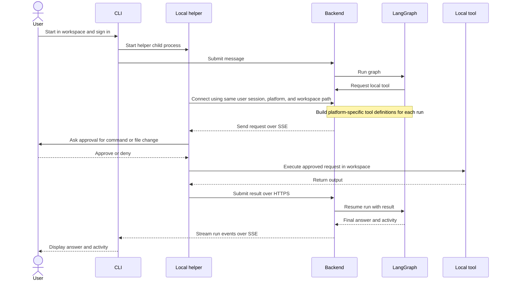
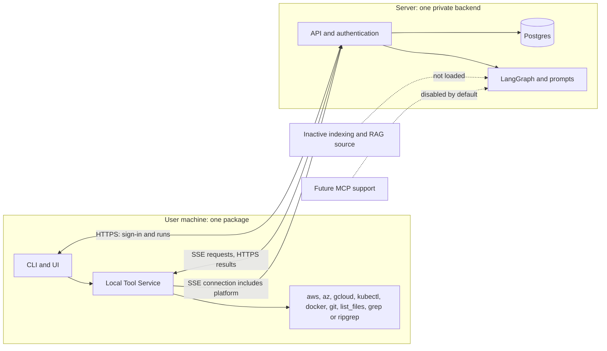

# Client and local Tool Service

Status: current architecture

## Product requirements

Ship the CLI and a local helper as one Python user package. The server is one private application containing authentication, conversation and run storage, LangGraph, model prompts, and orchestration. The server never mounts or reads the user's workspace. The local helper starts in the CLI launch directory, receives authenticated tool requests over SSE, executes locally, and returns results over HTTPS.

The active local tool families are `aws`, `az`, `gcloud`, `kubectl`, `docker`, `git`, and `files`. Shell commands use argument arrays and require approval every time. File reads and searches remain within the launch directory; writes and deletes require approval. File paths that resolve outside the workspace are rejected.

The file tools exposed to the agent are `files.list_files(path)` and one platform-specific search tool: Linux exposes `files.grep(pattern)` using the host `grep`; Windows exposes `files.ripgrep(pattern)` using the bundled `rg.exe`. Both search recursively from the CLI launch directory. The regex and file-selection behavior follows the platform's native search program. `list_files` requires an absolute directory path and rejects paths outside the launch directory. Search tools are not exposed on unsupported platforms.

The CLI reports its platform and absolute launch directory in headers when it opens the authenticated local-tool SSE stream. The backend stores this information for that connected user and uses it to build the run's LangChain tool list. Tool-list creation waits up to 10 seconds for a helper connection so a newly started CLI can report its platform before the agent runs. The workspace path is kept out of the request URL. Platform information only selects tools; it does not change authentication or the workspace restriction. Windows wheels include ripgrep 15.2.0 x64 and ARM64 binaries as package data. The downloaded archives were checked against the upstream SHA-256 values before extraction: x64 `71b2fef860abe467217a538ff31de02f5258807c0129f771846f87bd029aafc5`; ARM64 `e4abca10c3a64ebea742667dd7009449d49403db5460dd6873e389fa2945360f`. Both MIT and Unlicense notices ship beside each binary. Installation does not download binaries.

## Runtime interfaces

- `GET /v1/local-tools/stream`: authenticated SSE stream scoped to the signed-in user. `X-Local-Platform` and URL-encoded `X-Local-Workspace` headers identify the helper platform and absolute workspace path; the backend uses these only to prepare local tool definitions for that user.
- `POST /v1/local-tools/{call_id}/result`: authenticated result submission for a pending local call.
- Tool request: run ID, call ID, LangChain tool name/version, and a named `arguments` object. The helper passes the tool name and arguments unchanged to one `LocalToolExecutor.execute(name, arguments)` entry point. Command tools use an `argv` list plus optional workspace-relative working directory; `files.list_files` uses an absolute `path`; `files.grep` and `files.ripgrep` use a regex `pattern`.
- The local executor applies shared approval and workspace checks, then calls one ordinary function for the named tool. Command tools may share a subprocess function because they all use `argv`; file tools have separate implementations. The user package contains no LangGraph or agent orchestration code.
- Tool result: exit code, stdout, stderr, and elapsed milliseconds. The backend resumes the run with the result; execution errors are returned as failed results.
- The graph exposes supported operations as LangChain tools and uses the existing durable run worker to pause while the helper responds.
- Each server-side tool declares its own LangChain argument schema. To add a local tool, add its server definition and catalog entry, then add one client function and an explicit dispatcher route. Do not add another executor class or convert the tool's named arguments into positional strings.
- Only one helper may be connected per account at a time; this prevents a request from being routed to another CLI's workspace.

## Local tool contract and lifecycle

- `agent_protocol` is the source of truth for transport-safe local tool definitions: tool name, version, argument model, supported platform, and operation classification. Descriptions that depend on the connected workspace are composed by the backend.
- Argument shapes are shared Pydantic models. The broker uses them to reject malformed requests before queuing; the LangChain adapter uses the same models as native tool argument schemas. The client keeps explicit mappings from each supported definition to its local implementation. Workspace confinement, command limits, approval, redaction, and audit remain client execution policy.
- The broker owns helper connection metadata and pending-call state in the existing single-process in-memory implementation. A helper disconnect fails that user's pending calls promptly; reconnect starts a new helper session and does not revive calls from the closed stream.
- The local executor returns one structured result for supported, rejected, denied, and failed executions. Invalid requests are audited as rejected and do not reach approval or execution. The helper only serializes the executor result into the existing result transport fields.

## MCP and indexing

MCP clients and packages are removed in this release. AWS/GCP source prompts remain but the specialists are not registered. `DEVOPS_AGENT_ENABLE_MCP_AGENTS` defaults to false; if set true, startup fails with a message that MCP support is not available. Future MCP work can replace this gate after a separate design review.

`agent_server/indexing/`, `agent_server/utils/rag.py`, and `cocoindex-codebase-indexing.py` remain in the repository. The active API, agent hooks, and startup path must not import, construct, or invoke them. No indexing data is uploaded automatically.

## Waterfall

## Acceptance

- Building the user wheel includes `agent_cli` and `agent_protocol`, not `agent_server` or `agent_core`.
- The backend runs without MCP packages and without loading indexing/RAG modules.
- Each of the seven tool families can be requested, locally executed, and returned to the run.
- The agent sees `grep` on Linux and `ripgrep` on Windows based on the connected helper platform; `list_files` is available on both.
- The Windows CLI wheel contains the pinned x64 and ARM64 `rg.exe` binaries and the applicable license notice.
- Shell commands, file writes, and file deletes require approval; traversal outside the workspace fails.
- Tool-specific named arguments reach the local implementation without being flattened into positional strings.
- Helper reconnect uses the same sign-in and resumes receiving requests.
- Old WebSocket endpoints and server-hosted Tool Service endpoints are absent.
